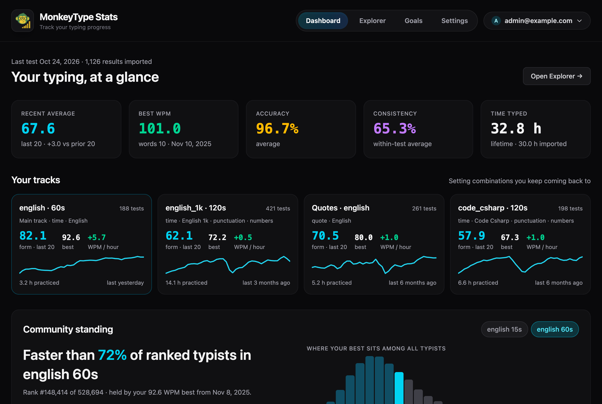
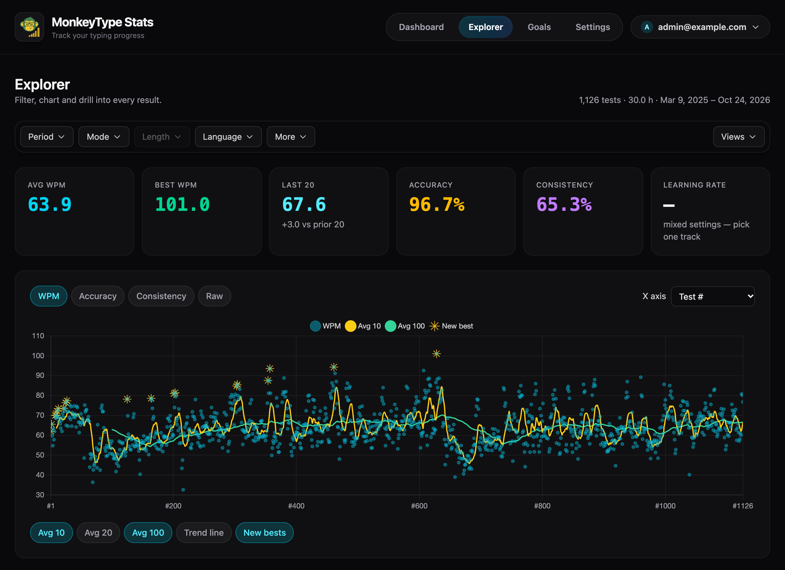
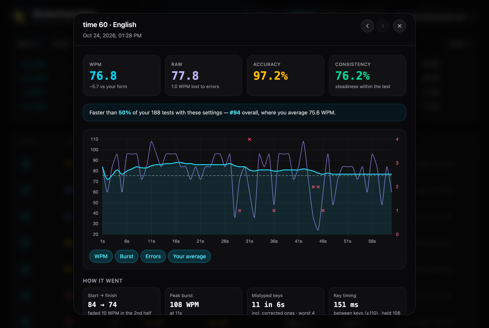

# monkeytype-stats

Unofficial MonkeyType test result exporter and dashboard.

## Why?

The built-in MonkeyType dashboard is limited to showing the latest 1000 results of a user. As far as my understanding goes, MonkeyType simply deletes any old result that falls out of this range, which makes it impossible to track long-term typing stats progress in case of active users.

The main goals of this project are:

- save my old MonkeyType results from disappearing
- enable deeper analysis of my typing stats
- learn about .NET Aspire in a fun way

## Tech stack
- .NET Aspire orchestration
- .NET 10 WebApi
   - Hangfire for scheduled jobs
- React SPA with TailwindCSS
   - TanStack Router and TanStack Query
   - Chart.js charts
   - stats computed in the browser, tested with Vitest
- PostgreSQL database
- Docker + Docker Compose

## Features

### Data

- Scheduled job that runs once every day and imports all new results from the MonkeyType API with ApeKey authentication.
  - The job can also be triggered manually from the Settings page (admin only).
- Scheduled job that runs hourly and fetches missing result details (needed for the per-second wpm/burst/error charts).
- JSON backup/restore of the database (admin only).

### Dashboard

- Vitals: recent average, best WPM, accuracy, consistency and time typed.
- Tracks: the setting combinations you keep coming back to, each with its form, best, learning rate and a sparkline.
- Community standing: leaderboard rank, where your best sits among all typists, rank history and lifetime stats from your MonkeyType profile.
- Insights ranked by how strong they are: accuracy, then vs now, language gap, learning curve, warm-up, time of day, weekday, endurance, break recovery and more. Each links to the matching Explorer view.
- Activity heatmap (similar to the one on the MonkeyType Account page), personal bests and a goals summary.

### Explorer

- Sticky filter bar for period, mode, length, language and more. Filters live in the URL and can be saved as views.
- KPIs and a chart of WPM, accuracy, consistency or raw by test number or date, with rolling 10/20/100 averages, a trend line and new-best markers.
- Breakdown table grouped by month, week, weekday, hour, position in session, language, mode & length or accuracy band. Click a row to drill down.
- Results table with a details view for every test: headline stats compared with your form, rank among tests with the same settings, a per-second wpm/burst/error chart, pace analysis and character breakdown. Step through tests with ← / →.

### Goals

- Form, personal best, accuracy, practice volume, streak and leaderboard goals with progress, history and a rough time-to-goal estimate.

### Settings

- Manual import, backup/restore, display preferences (date format and first day of the week) and version info.

## Deployment guide

1. Create and enable an ApeKey on your [MonkeyType Account settings page](https://monkeytype.com/account-settings?tab=apeKeys).
2. Use the example [docker-compose.yaml](compose/docker-compose.yaml) and [.env.example](compose/.env.example) files to deploy the application to you homelab.

Before deployment adjust the image versions in the docker-compose.yaml to use the latest images and set up the variables in the .env file.

Changing data (goals, saved views, imports, backups) requires logging in as the admin, and the Settings page is only visible once you're logged in. The API key from MONKEYTYPE_STATS_API_KEY still works for scripts and the Bruno collection.

### Admin login

All endpoints that change data accept either the API key or a logged-in admin session (cookie, via `POST /api/auth/login`).
There is exactly one admin account and no registration:

- `MONKEYTYPE_STATS_ADMIN_EMAIL` / `MONKEYTYPE_STATS_ADMIN_PASSWORD`: the admin account is created from these on first boot. Changing the email later renames the existing admin.
- The password is only applied when the account is created. To change it, update `MONKEYTYPE_STATS_ADMIN_PASSWORD`, set `MONKEYTYPE_STATS_ADMIN_RESET_PASSWORD=true` for one restart, then set it back to `false`.
- `MONKEYTYPE_STATS_AUTH_DISABLED=true` turns off login and API key protection completely. Only use this for a stack that is not reachable from the internet.

Example deployment: [typing.kovacsgellert.dev](https://typing.kovacsgellert.dev)

## AI usage disclosure

The frontend was pretty much 100% vibe-coded.
I'm a backend guy with mainly .NET experience, so at the time of writing, my knowledge of React and Tailwind CSS is limited.

## Screenshots

### Dashboard

### Explorer

### Result details

